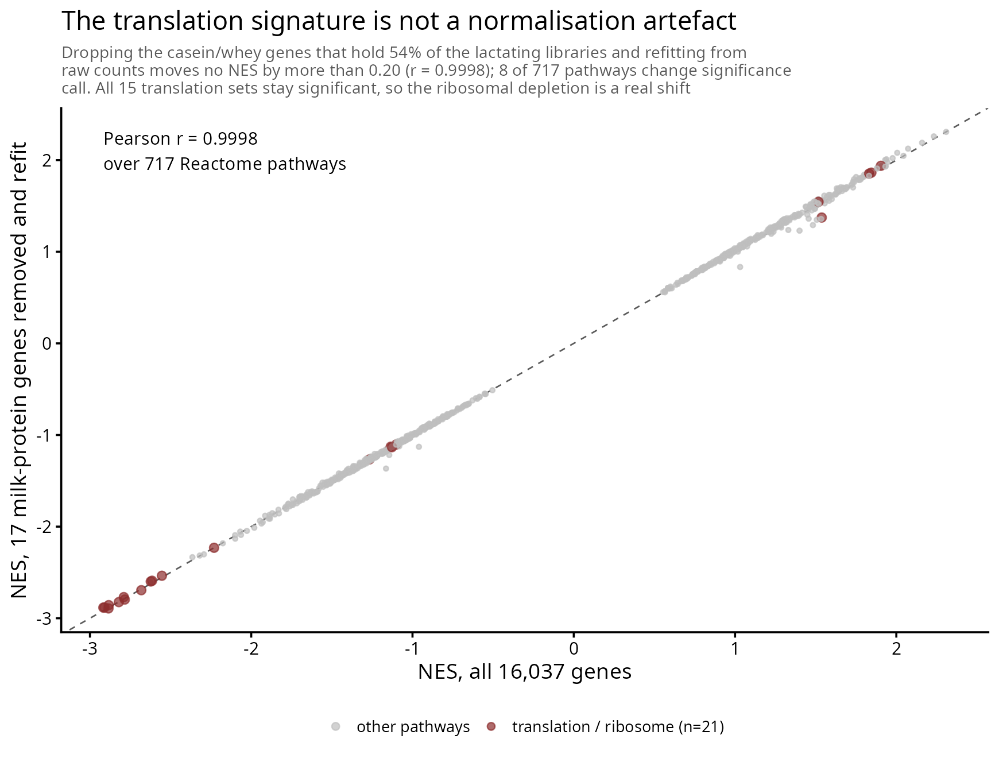
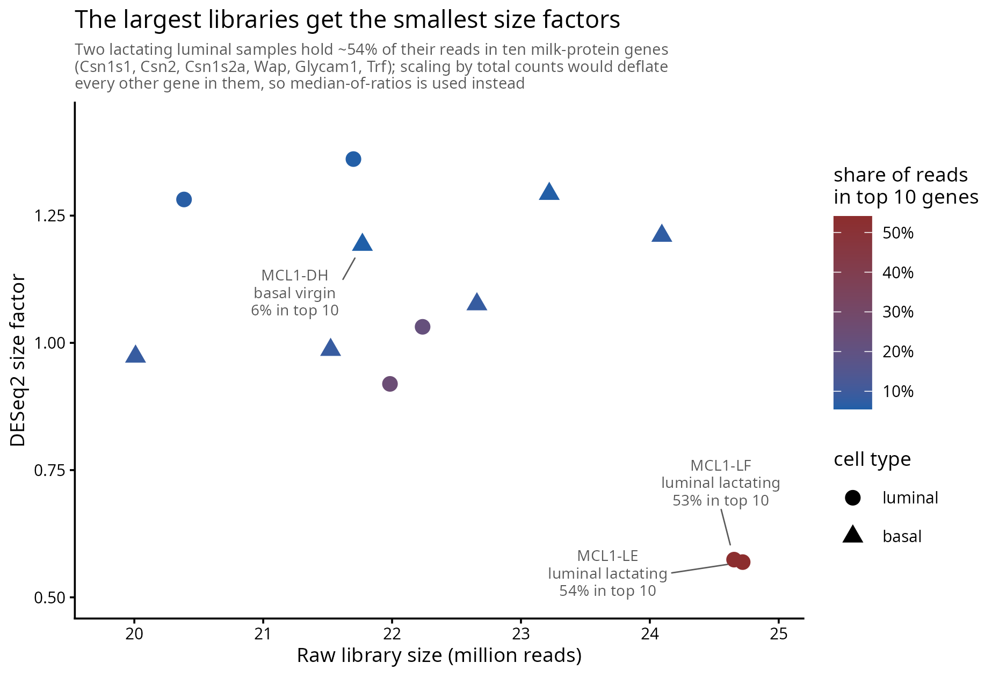
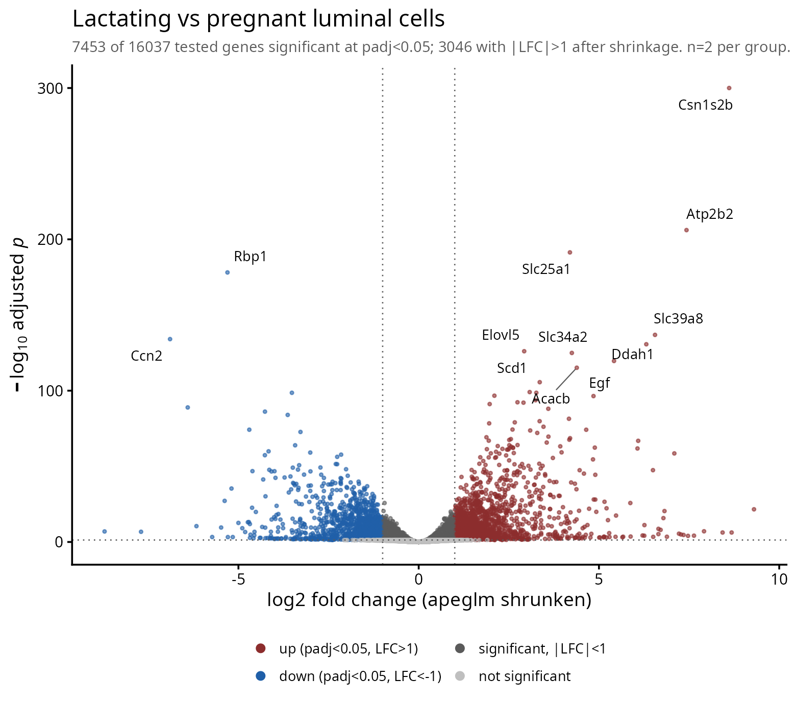
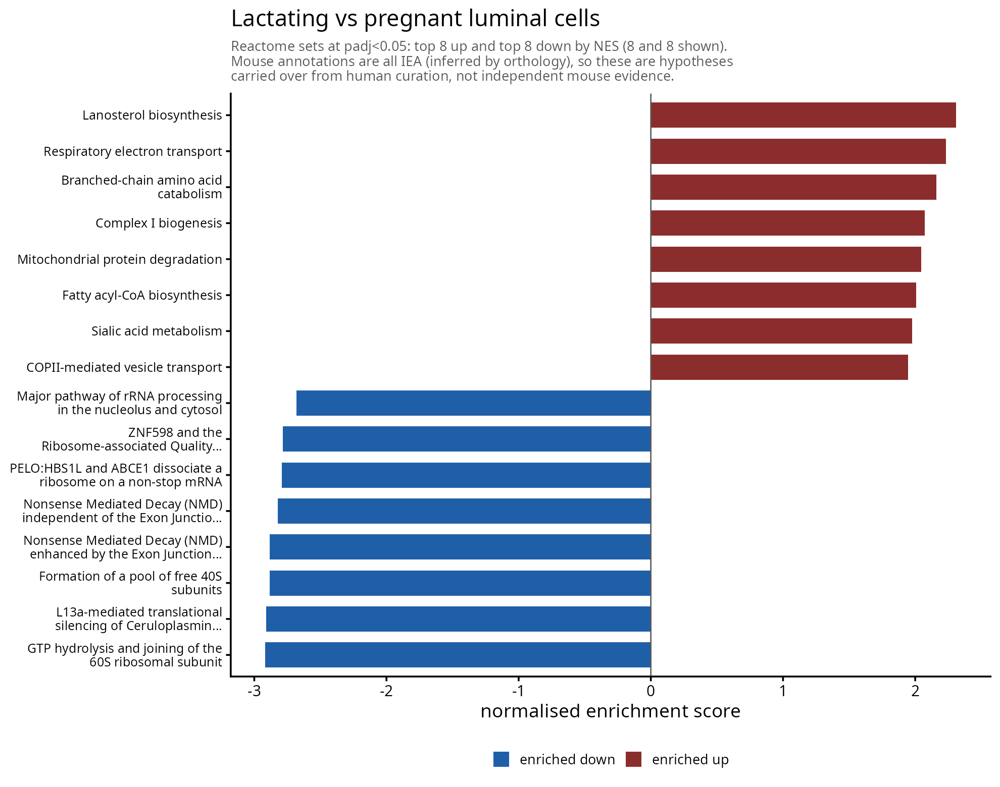

# RNA-seq differential expression: mouse mammary gland (GSE60450)

[](https://github.com/TilakSharma07/rnaseq-de-GSE60450/actions/workflows/ci.yml)

[](https://github.com/TilakSharma07/rnaseq-de-GSE60450/actions/workflows/ci.yml)
[](LICENSE)

End-to-end DESeq2 + fgsea pipeline on a public dataset, with the sample-mapping
trap, the composition-bias question, and the annotation-provenance question all
handled explicitly rather than assumed away.

Run locally with R 4.5.3 / Bioconductor 3.22 (DESeq2 1.50.2, fgsea 1.36.2,
apeglm 1.32.0); `results/session_info.txt` records the exact versions behind
every number in this README.

```bash
./download_data.sh        # ~40 MB from GEO, NCBI, Reactome; idempotent
Rscript tests/run_tests.R # 23 tests
Rscript run_pipeline.R    # ~70 s -> results/
```

Or reproduce the whole thing in a pinned container:

```bash
docker build -t rnaseq-de .
docker run --rm -v "$PWD/results:/pipeline/results" rnaseq-de
```

## Dataset

[GSE60450](https://www.ncbi.nlm.nih.gov/geo/query/acc.cgi?acc=GSE60450) — Fu et
al. 2015, *Nature Cell Biology*. Mouse mammary gland, basal and luminal cell
populations sorted at three developmental stages (virgin, 18.5 d pregnant,
2 d lactating), 2 biological replicates per group. 27,179 genes × 12 libraries;
16,037 genes retained after filtering (≥10 reads in ≥2 samples).

Two contrasts are reported:

| contrast | n significant (padj<0.05) | \|LFC\|>1 after shrinkage | up | down |
|---|---|---|---|---|
| basal vs luminal, virgin | 9,466 | 5,145 | 3,140 | 2,005 |
| lactating vs pregnant, luminal | 7,453 | 3,046 | 1,801 | 1,245 |

With n=2 per group these are exploratory: the design is minimally replicated,
so the gene *ranking* is more trustworthy than any individual p-value.

## The three things this pipeline gets right

**1. Sample mapping is joined by label, never by position.**
The counts matrix lists basal libraries first (`MCL1-DG..DL`); the GEO series
matrix lists luminal first. Assigning sample titles positionally swaps the two
cell populations across all 12 libraries and inverts every fold change — with
no error raised anywhere downstream. The link is the `Sample name: MCL1-xx`
field inside `!Sample_description`. `build_sample_sheet.R` joins on it,
`R/01_load.R` re-asserts it at load time, and `tests/test_pipeline.R` carries a
regression test that rejects a positionally-scrambled sheet.

The sample sheet is also derived twice, independently — once in R
(`build_sample_sheet.R`), once in Python during development — and the two
outputs are byte-identical.

**2. The comparison direction is pinned by biology, not by convention.**
`contrast_table(dds, "luminal_pregnant", "luminal_lactating")` is a perfectly
valid DESeq2 call that inverts every sign, and nothing in `de_summary.csv`
would notice: the counts are either sign-agnostic (`n_sig`, `n_strong`) or
simply exchange (`n_up` ↔ `n_down`). So `positive_control()` in `R/02_de.R`
asserts what has to be true outside the count matrix — milk-protein genes are
induced in lactation — and stops the run before any figure is written:

| marker | shrunken log2FC | padj |
|---|---|---|
| Csn2 | +1.92 | 1.8e-06 |
| Wap | +3.75 | 2.9e-40 |
| Lalba | +3.63 | 3.5e-17 |
| Csn1s1 | +2.15 | 6.9e-18 |
| Csn1s2a | +1.91 | 2.7e-18 |

The markers are named by symbol and resolved through the annotation, so the
check cannot be satisfied by whichever genes happen to top the table. The test
suite runs it both ways: forward must pass, and the swapped contrast must raise.

**3. The headline enrichment result is tested against its own artefact
explanation.** Both contrasts return strong *negative* enrichment for ribosome
and translation pathways. That is exactly what a normalisation failure would
also produce here: 17 milk-protein and secretory genes occupy **54.0%** and
**53.0%** of the two lactating libraries (**40.0%** and **39.2%** in the
caseins and whey alone), and if size-factor estimation were absorbing that,
everything else would be pushed down together.

So `R/06_sensitivity.R` drops the milk-protein genes by gene family (not by
"top N expressed", which would make the exclusion set depend on the libraries
under test), refits from raw counts — new size factors, new dispersions, new
tests — and reruns the enrichment. Result: NES correlation **0.9998** across
all 717 pathways, no score moving by more than 0.20, and every one of the 15
significant translation sets (of 16 present) still significant — none drops
out. The signature is a real relative shift, not an artefact.
Median-of-ratios was already robust to those 17 genes: removing them moves no
size factor in any of the 12 libraries by more than 0.0014, and the two
lactating libraries — the ones holding 54% and 53% of their reads in milk
protein — move by 0.0005 and 0.0007.



**4. Annotation provenance is a file, not a package version.**
Gene symbols come from NCBI `Mus_musculus.gene_info`, pathways from Reactome
`NCBI2Reactome.txt`, both fetched by `download_data.sh` and recorded with size
and mtime in `results/annotation_provenance.csv`. No `org.Mm.eg.db`.

This also surfaces a caveat that usually goes unstated: **all 30,583 mouse
Reactome annotations carry the IEA evidence code** — inferred electronically,
largely by orthology from human. Not one is a traceable experimental statement
in mouse. Every enriched pathway below is therefore a hypothesis inherited from
human curation, and the figures say so on their face.

## Results

Basal vs luminal separates on PC1 (86% of variance); developmental stage orders
monotonically along PC2 (9%).



The lactating libraries are the largest by raw count yet receive the *smallest*
size factors — the composition-bias signature that motivated the sensitivity
analysis above.

Direction checks that would immediately expose mislabelling: the basal contrast
puts *Krt5*, *Acta2*, *Mylk*, *Tpm2* and *Col17a1* (myoepithelial and basement
membrane) up; the lactation contrast puts *Csn1s2b*, *Scd1*, *Elovl5* and
*Acacb* (milk protein, lipid synthesis) up.



Enrichment in the lactation contrast is coherent with the tissue's job: up on
lanosterol and fatty acyl-CoA biosynthesis, respiratory electron transport,
Complex I biogenesis and COPII vesicle transport; down on ribosome assembly,
translation initiation and rRNA processing.



## Layout

```
download_data.sh          fetch GEO + NCBI + Reactome inputs (idempotent)
build_sample_sheet.R      derive sample sheet from the series matrix
run_pipeline.R            end-to-end runner, ~70 s
R/00_annotation.R         NCBI symbols, Reactome sets, provenance record
R/01_load.R               counts + sheet, with label-join assertions
R/02_de.R                 DESeq2 fit, contrasts, apeglm shrinkage
R/03_qc_figures.R         library size vs size factor, PCA
R/04_de_figures.R         volcano, MA
R/05_enrichment.R         fgsea over Reactome
R/06_sensitivity.R        refit without milk genes; artefact test
tests/                    23 testthat tests, incl. the ordering regression
                          and the contrast-direction positive control
Dockerfile                pinned Bioconductor 3.22
.github/workflows/ci.yml  tests on push; full pipeline weekly
```

## Method notes

- **Shrinkage.** Effect sizes are `apeglm`-shrunken; significance comes from the
  unshrunken Wald test. Volcano and MA plots use shrunken LFC on the x-axis and
  unshrunken significance on the y-axis. The two disagree on the |LFC|>1 count
  by 150–300 genes per contrast, so `summarise_contrast()` returns both and the
  pipeline reports the shrunken count everywhere, matching the plotted axis.
- **GSEA ranking** uses the Wald statistic, not shrunken LFC: the statistic
  already combines effect and precision, so ranking by a shrunken value would
  apply the prior twice.
- **Gene labels** in volcano plots are chosen by adjusted p-value, not fold
  change, so a large-but-noisy gene never gets named.

## Reference

Fu NY, Rios AC, Pal B, et al. EGF-mediated induction of Mcl-1 at the switch to
lactation is essential for alveolar cell survival. *Nat Cell Biol* 17:365–375
(2015). doi:10.1038/ncb3117
